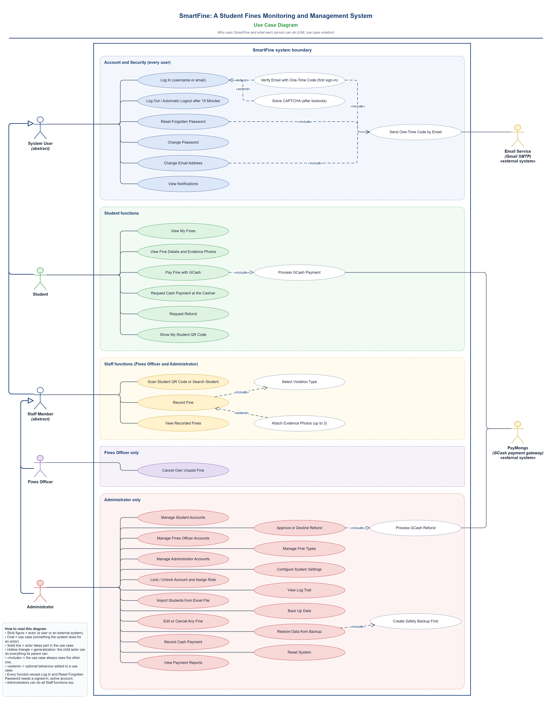
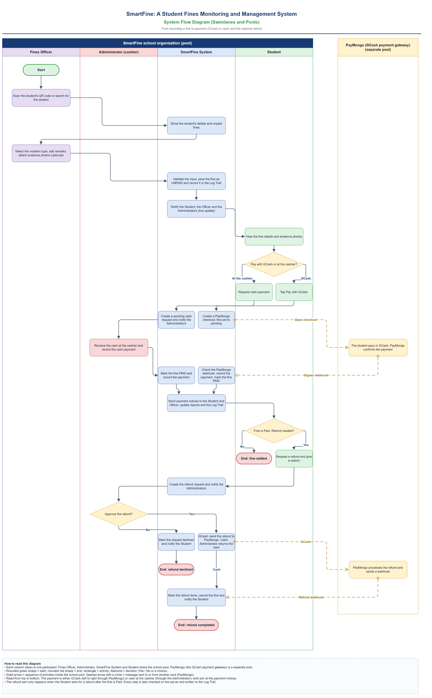
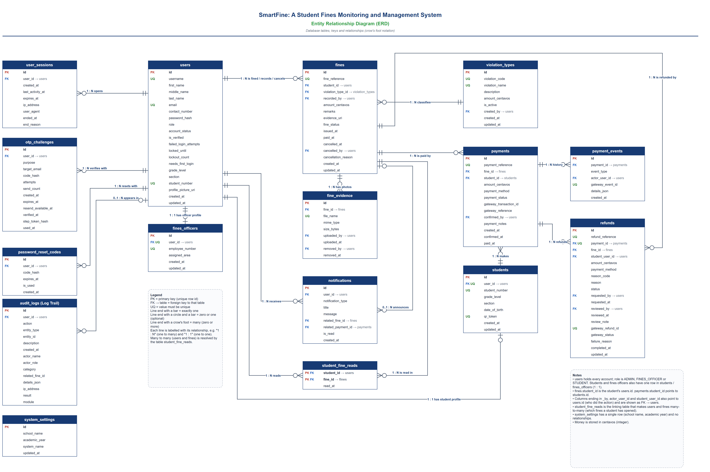
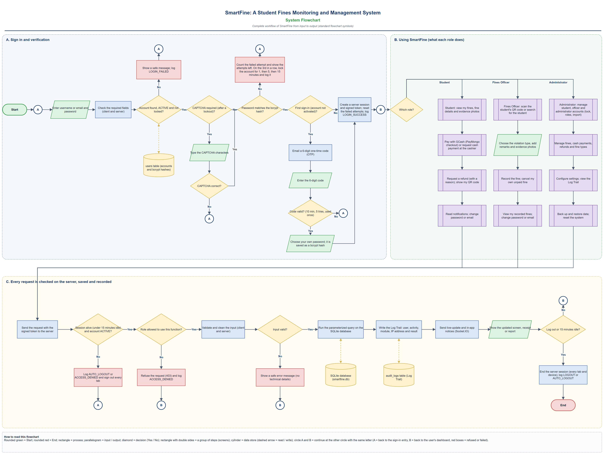
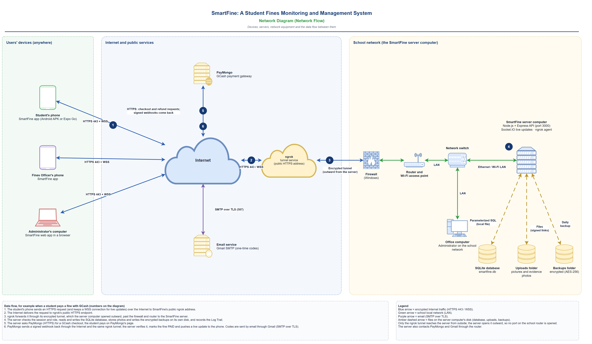

# SmartFine

**A student fines monitoring and management system for schools.** Fines Officers record fines by scanning a student's QR code, students see and pay their fines (GCash through PayMongo, or cash at the cashier), and administrators manage everything from one dashboard.

SmartFine is an Expo / React Native app (Android and web) backed by a Node.js + Express API with a SQLite database. It was built as a school project.

---

## Roles

| Role | What they do |
| --- | --- |
| **Administrator** | Manages students, Fines Officers, other administrators, fines, fine types, payments, refunds, reports, backups and school settings. |
| **Fines Officer** | Scans a student's QR code and records a fine, with up to 3 evidence photos. Looks up students and their fine records. |
| **Student** | Sees their fines, pays them, shows their QR code, gets notifications, keeps receipts and asks for refunds. |

## Main features

**Administrator**
- Dashboard with summary cards and a notification bell for new fines and payment requests.
- Students: add, edit, activate/deactivate, and import whole sections from an Excel (`.xlsx`) or CSV file using a downloadable template.
- Fines Officers and administrators: add, edit, remove; lock/unlock accounts and change staff roles.
- Fines: record (also from the QR scanner), edit and cancel fines; see who recorded, collected, refunded or cancelled each one, with its evidence photos.
- Fine types (violation types) and their amounts, maintained in Settings.
- Cash collections recorded by the administrator who received the money; refunds approved or rejected (GCash refunds go through PayMongo).
- Reports: payment totals and a transactions list.
- Log Trail: who did what, when, from which IP address, and whether it succeeded, failed or was denied.
- Encrypted database backups (automatic daily and manual), download, import, restore and delete.
- System Reset for a new school year (saves an encrypted backup first).

**Fines Officer**
- Camera QR scanner and a three-step "record fine" flow with optional evidence photos.
- Student list with grade and section filters, and the records of fines.

**Student**
- Dashboard and My Fines with live status.
- Personal QR code to show to a Fines Officer.
- Pay online with GCash through PayMongo Checkout, or ask to pay cash at the cashier.
- Digital receipt for each payment: view, save as PNG, or share.
- Refund requests for completed payments.
- In-app notifications with a notice banner and chime.
- Profile photo, change password, change email.

**Everyone**
- Screens refresh by themselves when data changes (Socket.IO live updates).
- First sign-in of a new account verifies the email with a one-time code; forgot password works the same way.

## Security features

- **Passwords**: hashed with bcrypt; 8–72 characters with upper and lower case letters, a number and a special character.
- **Server-side sessions**: a sign-in token works only while its session is alive. Logging out ends it everywhere; 15 minutes without activity signs the person out; a password change, lock, deactivation or role change ends the account's sessions.
- **Brute-force protection**: after 3 failed sign-ins the account is locked for 1, then 5, then 15 minutes, and after a lockout every attempt needs a picture CAPTCHA that SmartFine draws itself (no outside service). Per-IP rate limits on sign-in, CAPTCHA and password-reset requests.
- **One-time codes**: 6 digits, expire after 10 minutes, work once, 5 wrong tries end the request, and only a keyed hash is stored.
- **Access control**: every API route checks the token, the role and that the account is still active, against the database on every request.
- **Request hardening**: JSON bodies are sanitized (control characters and HTML tags removed, size and depth limits), all SQL uses parameterized queries, errors never expose stack traces or database text, and security headers are set (`nosniff`, no framing, no caching of API answers).
- **Tamper-resistant Log Trail**: database triggers refuse edits and deletes of log rows; passwords, hashes, codes, tokens and session IDs are never written to it.
- **Private evidence photos**: blocked from the public uploads folder and served only through signed links that expire.
- **Payments**: a fine becomes Paid only after PayMongo confirms it (a webhook verified with HMAC-SHA256, or the server asking PayMongo directly); confirmations are idempotent.
- **Encrypted backups**: AES-256-GCM with a key kept outside the code and outside the backup folder; downloading a backup needs the administrator's password.
- **Secrets stay out of git**: API keys live in `server/.env`; the token-signing key and backup key are generated on first start into git-ignored files.

## Tech stack

| Part | Technology |
| --- | --- |
| App | Expo SDK 58, React Native 0.88, React 19, TypeScript, Expo Router (file-based routes) |
| App libraries | expo-camera (QR scanner), react-native-qrcode-svg, expo-image-picker, expo-document-picker, react-native-view-shot / html2canvas-pro (receipt images), socket.io-client |
| Backend | Node.js, Express 5, Socket.IO, built-in `node:sqlite` (SQLite) |
| Backend libraries | bcryptjs, jsonwebtoken, multer (uploads), exceljs (student import), nodemailer (Gmail), dotenv |
| Services | PayMongo Checkout (GCash, test mode), Gmail SMTP (one-time codes), ngrok (public HTTPS address during development) |

## Project structure

```
app/                  Screens (Expo Router)
  admin/              Administrator: dashboard, students, officers, fines, reports, settings, QR scanner
  officer/            Fines Officer: dashboard, QR scanner, record fine, students, records, profile
  student/            Student: dashboard, fines, QR code, profile
  login/              Sign-in, first sign-in verification, forgot password
  payment-return/     Landing page after a PayMongo checkout
components/           Shared UI (modals, notice banner, receipts, refunds, pagination, ...)
hooks/                Auth, role guard, live updates, notification counts, ...
utils/                API fetch helper, session guard, validation, downloads, ...
constants/api.ts      Backend address (EXPO_PUBLIC_API_URL)
server/
  server.js           Express app and Socket.IO
  init-db.js          Creates a new, empty database with the first administrator
  routes/             REST API, one file per module
  security/           Sessions, CAPTCHA, one-time codes, rate limits, hardening, mailer, keys
  payments/           PayMongo client, online payments, refunds
  middleware/         Role and account checks
  database/           SQLite connection, schema.sql, Log Trail, backups, system reset
docs/diagrams/        System diagrams (PNG, draw.io sources and a Word document)
```

## Getting started

### Requirements

- Node.js with the built-in `node:sqlite` module (developed and tested with Node.js 25.6) and npm.
- For phones: a public HTTPS address for the backend, for example [ngrok](https://ngrok.com).
- Optional: a Gmail account with an app password (one-time codes) and a PayMongo account in test mode (GCash).

### 1. Install

```bash
npm ci
cd server
npm ci
```

### 2. Configure the backend

Copy `server/.env.example` to `server/.env`. Each setting is explained in the file. For a first run you only need:

```env
INIT_ADMIN_USERNAME=admin
INIT_ADMIN_EMAIL=you@example.com
INIT_ADMIN_PASSWORD="Choose#AStrong1"
```

Use double quotes around a value that contains `#`. Add `SMARTFINE_EMAIL_USER` / `SMARTFINE_EMAIL_APP_PASSWORD` to send one-time codes, and `PAYMONGO_SECRET_KEY` (an `sk_test_...` key) for GCash payments.

### 3. Create the database

From the `server` folder:

```bash
node init-db.js
```

This creates `server/database/smartfine.db` from `server/database/schema.sql` (structure only, no data) with one administrator. It refuses to run if a database already exists. The first administrator can sign in straight away, without the email code. You can then remove `INIT_ADMIN_PASSWORD` from `server/.env`.

A new database has no fine types yet: add them in **Settings** before recording fines.

### 4. Start the backend

```bash
node server.js
```

`http://localhost:3000/` answers `{"success":true,"message":"SmartFine API is running."}`.

### 5. Configure and start the app

Copy `.env.example` to `.env` in the project root and set the backend's public address for phones:

```env
EXPO_PUBLIC_API_URL=https://your-tunnel.example.com
```

The web version always uses `http://localhost:3000`. `EXPO_PUBLIC_` values are built into the app, so put only the URL here, never a secret.

```bash
npx expo start
```

Press `w` for the web version, or open the app on a phone with Expo Go.

### Optional: public address and GCash

```bash
ngrok http 127.0.0.1:3000
```

With `PAYMONGO_SECRET_KEY` set, register the payment webhook once (and again whenever the public address changes), from the `server` folder:

```bash
node setup-paymongo-webhook.js https://your-tunnel.example.com
```

### Building an APK with EAS

EAS Build does not upload `.env` (see `.easignore`), so give the build the same variable, either in the project's EAS environment variables or in the build profile in `eas.json`:

```json
"preview": {
  "distribution": "internal",
  "android": { "buildType": "apk" },
  "env": { "EXPO_PUBLIC_API_URL": "https://your-tunnel.example.com" }
}
```

## Diagrams

The draw.io sources and a Word document with all five diagrams are in [`docs/diagrams`](docs/diagrams).

### Use case diagram


### System flow (swimlanes)


### Entity relationship diagram


### System flowchart


### Network diagram


## Author

Will R. Bitoy
